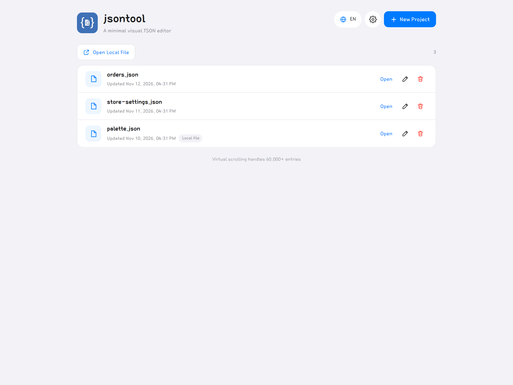
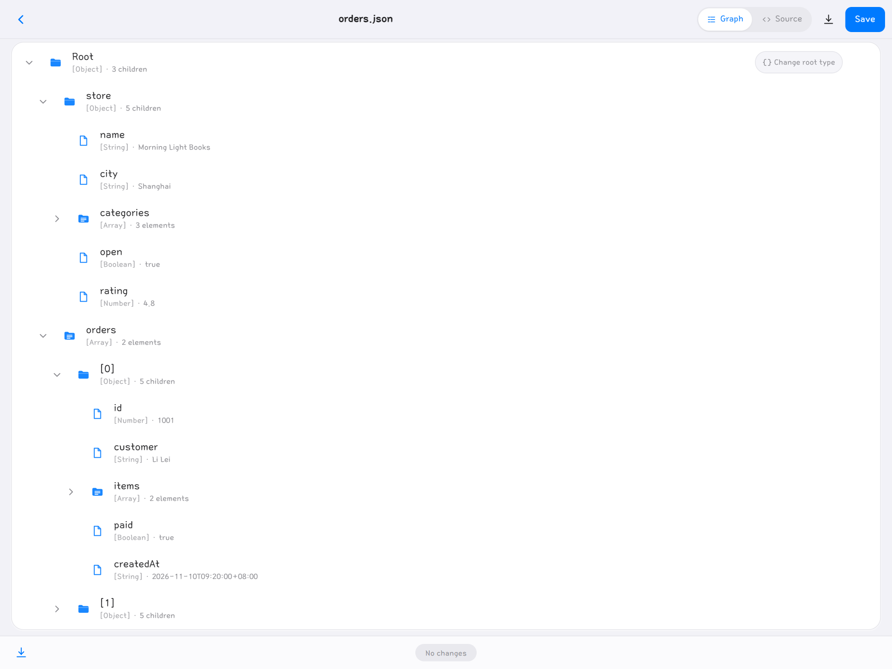
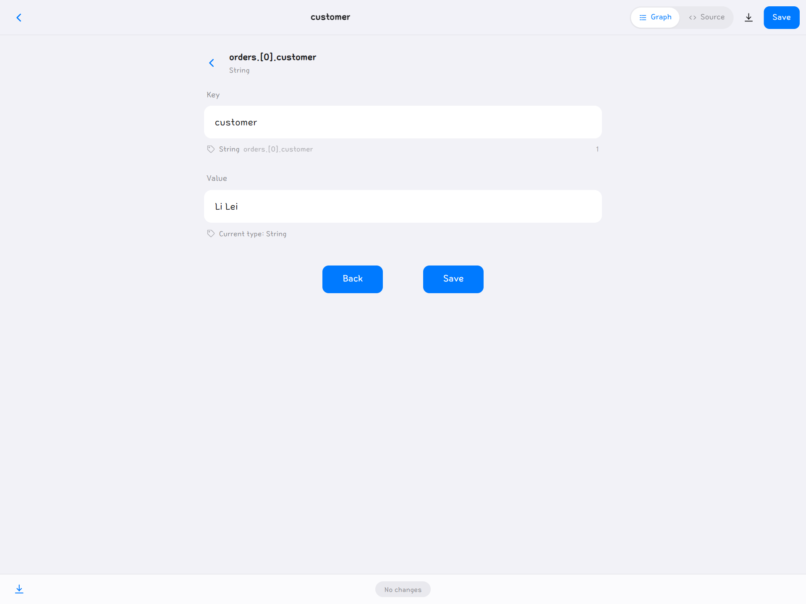
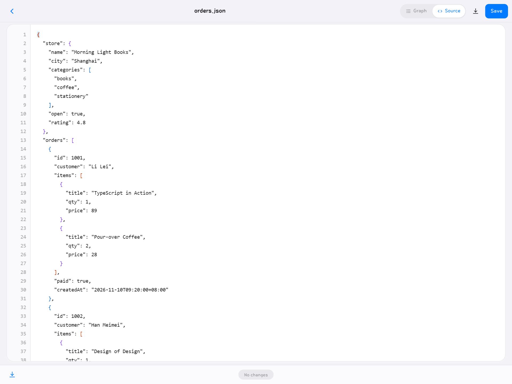
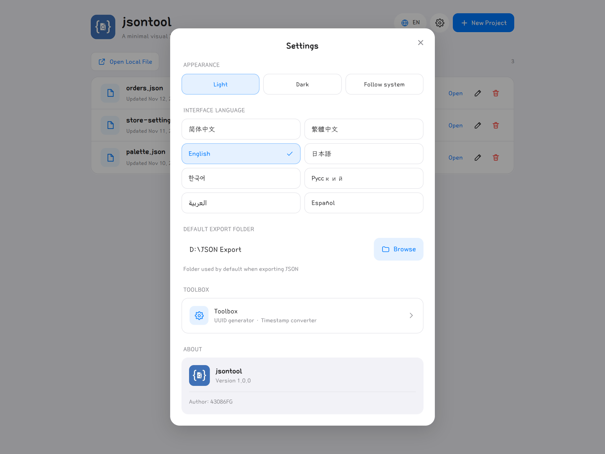
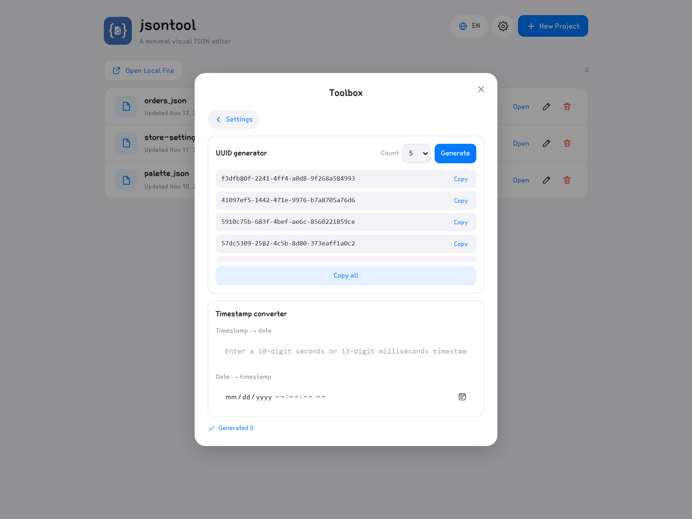
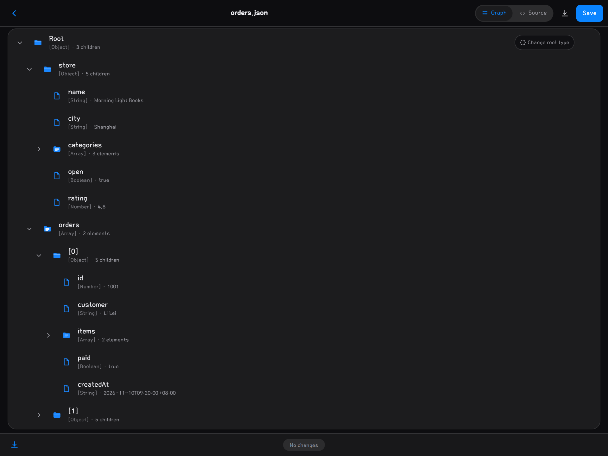
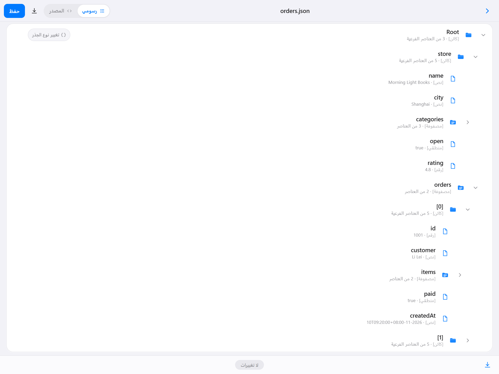

# jsontool

一个面向 Windows 的极简 JSON 编辑器，界面参考 Apple iOS 风格（浅色 / 深色 / 跟随系统）。图形树视图与源码编辑双模式、8 种界面语言、超大 JSON 虚拟滚动，安装包仅注册“打开方式”而不劫持 `.json` 默认程序与系统图标。

A minimal Windows JSON editor with an iOS-like look (light / dark / system). It offers a graph tree view and a code-editor mode, 8 UI languages, virtual scrolling for huge files, and an installer that only registers an "Open with" entry without hijacking `.json` defaults or system icons.

[简体中文](#简体中文) · [English](#english)

---

## 简体中文

### 简介

jsontool 把 JSON 当作可展开的结构来编辑：树形视图逐层浏览与增删改，源码模式则提供带括号着色、错误行定位的编辑器。所有修改即时可见，未保存状态有明确提示，关闭窗口前会询问是否保存。

- 作者：43086FG
- 许可证：MIT（见 `LICENSE`）
- 平台：Windows 10/11 x64；Windows 7 SP1 需 WebView2 Runtime 109
- 版本：1.0.0

### 截图

以下截图取自真实运行的应用（1280×960 窗口，2 倍缩放导出）。

**主页：项目列表与新建入口**



**树形视图：嵌套对象与数组，带类型与数量标注**



**详情编辑：键名、类型与值**



**源码模式：行号、语法高亮与配对括号着色**



**设置：主题、界面语言与默认导出路径**



**工具箱：UUID 生成与时间戳转换**



**深色主题**



**阿拉伯语 RTL 布局**



### 功能

**主页**
- 项目列表：新建（自动 `untitled.json`，重名递增为 `untitled1.json`）、打开、重命名、导出、删除。
- 重命名只改主名，扩展名（如 `.json`）以灰色固定后缀展示，不可编辑；本地导入文件保留原扩展名。
- 右键菜单：打开 / 重命名 / 导出 / 删除；导出使用两空格缩进，优先写入设置中的默认导出路径，未设置则弹出保存对话框。
- 支持“打开本地文件”与拖入 `.json`；列表滚动位置在增删改、进出编辑器后保持不变。

**树形视图**
- 虚拟滚动（固定 56px 行高），数万节点仍流畅；目录默认折叠。
- 虚拟 `Root` 代表文档顶层，标注 `[对象]` / `[数组]`，可一键“更改根类型”（对象 ↔ 数组，带确认并标记未保存）。
- 行内提供折叠箭头、类型图标、名称（过长省略并带悬浮提示）、悬浮 `+`；右键支持编辑 / 复制 / 删除 / 插入。
- `+` 按类型生成默认值（`newKey` / `newItem`，重名递增）；数组额外提供“带标签的值”，生成 `{"newKey": ""}` 并直达编辑页。
- 深层节点保持固定缩进步长，树区域提供横向滚动条；仅树内部滚动，窗口不出现整页滚动。

**详情编辑页**
- Key / Value 卡片表单，实时显示值类型；底部“返回 / 保存”。
- 新建节点点“返回”取消创建并恢复未保存状态；已有节点返回则放弃本次修改；仅“保存”提交。

**源码模式（CodeMirror 6）**
- 本地打包，不走 CDN；行号与代码同步滚动，等宽字体、平滑滚动，大文件输入不卡顿。
- 纵向 / 横向滚动条常显且可拖动，颜色随主题变化。
- 括号按嵌套深度三色循环着色；光标在括号旁时配对括号加粗高亮，缺失配对给出提示。
- 语法错误行低饱和红底高亮并自动滚动定位；非法 JSON 只能停留在源码模式。

**主题与语言**
- 浅色 / 深色 / 跟随系统，默认跟随系统；切换即时生效、带过渡并持久化，重启保持。
- 覆盖主页、树、详情、编辑器、弹窗、右键菜单、设置与工具箱；深色下编辑器、括号配色、错误行、行号单独适配。
- 8 种语言：简体中文、繁體中文、English、日本語、한국어、Русский、العربية（RTL）、Español；键名永不翻译。

**设置与工具箱**
- 分区：外观、界面语言、默认导出路径、工具箱、关于；无“完成”按钮，× / Esc / 遮罩关闭即保存。
- “浏览”在桌面版调用系统目录选择；浏览器预览下提示“仅桌面版可选择目录”并允许手输。
- 工具箱：UUID v4 生成（可选 1/5/10/20 条，单条 / 全部复制）与时间戳转换（10 位秒 / 13 位毫秒自动识别，本地时间含时区 + UTC；日期时间 → 秒和毫秒），均带即时反馈。

**系统集成**
- 关闭窗口有未保存修改时询问是否保存；保存 / 导出统一 `JSON.stringify(data, null, 2)`。
- 安装包注册资源管理器“打开方式”（`Applications\jsontool.exe` + `SupportedTypes=.json`），启动参数直接进入编辑器；双击应用图标进入主页。
- 安装向导启动时始终显示语言选择，8 种语言均可选。

### 技术栈

| 层 | 技术 |
| --- | --- |
| 桌面壳 | Tauri 1.5（Rust + WebView2） |
| 前端 | React 18 + TypeScript + Vite 5 |
| 编辑器 | CodeMirror 6（`@codemirror/lang-json`，本地打包） |
| 样式 | Tailwind CSS 3（CSS 变量色板） |
| 多语言 | i18next + react-i18next |
| 打包 | Inno Setup 6.2.2 |

### 目录结构

```
.
├─ src/                      # React 前端
│  ├─ components/            # Icon / TypeIcon / Modal / Toast / SettingsSheet / Toolbox
│  ├─ pages/                 # HomePage / EditorPage
│  ├─ views/                 # TreeView / DetailView / SourceView（CodeMirror 6）
│  ├─ lib/                   # JSON 路径操作、解析、主题、Tauri / 浏览器 API 封装
│  ├─ locales/               # 8 种语言资源
│  └─ i18n.ts
├─ public/                   # logo 与内置字体
├─ src-tauri/                # Rust 后端、tauri.conf.json、图标
├─ installer/                # Inno Setup 脚本、自定义语言文件、安装包产物
├─ LICENSE
├─ THIRD-PARTY-NOTICES.md
└─ README.md
```

### 环境要求

- Node.js 18+ 与 npm
- Rust **1.77.2**（由 `rust-toolchain.toml` 固定；1.78 起标准库不再支持 Windows 7/8.1，锁定该版本以保留 Win7 SP1 兼容性）
- Visual Studio Build Tools（“使用 C++ 的桌面开发”工作负载 + Windows SDK）
- Inno Setup 6.2.2（仅打包安装程序时需要）

### 开发与构建

```powershell
npm install

# 开发：Tauri 窗口 + 热更新
npm run tauri:dev

# 前端类型检查 + 生产构建（输出 dist/）
npm run build

# 编译桌面程序（输出 src-tauri/target/release/jsontool.exe）
npm run tauri:build
```

> 若终端安全软件拦截 cargo 的构建脚本（表现为 `拒绝访问 (os error 5)`），请把 `src-tauri/target` 或自定义的 `CARGO_TARGET_DIR` 加入信任列表。

### 打包安装程序

```powershell
# 先完成 npm run tauri:build
& "${env:ProgramFiles(x86)}\Inno Setup 6\ISCC.exe" installer\jsontool.iss
# 产物：installer/jsontool-Setup-1.0.0.exe
```

- 安装向导强制显示语言选择（`ShowLanguageDialog=yes`），8 种语言可选；4 个自定义 `.isl` 以 `Default.isl` 为基底叠加，避免缺键回退。
- 卸载会删除安装目录、`Applications\jsontool.exe` 注册项与 `FileExts\.json\OpenWithList` 残留，保留用户数据目录。
- 安装包未签名，首次运行可能触发 SmartScreen 提示。
- Windows 7 SP1 仅支持 WebView2 Runtime 109；若把 `installer/redist/MicrosoftEdgeWebView2Setup.exe` 放入 `installer/redist/`，安装时会静默安装，否则安装结束提示手动安装。

### 多语言与主题

- 语言资源位于 `src/locales/*.json`，新增键时 8 个文件需同步；阿拉伯语通过 `dir=rtl` 与逻辑属性（`ms/me/ps/pe/start/end`）镜像布局。
- 主题通过 CSS 变量（RGB 三元组）驱动，`html[data-theme='dark']` 覆盖色板；切换入口在设置 → 外观。

### 授权

- 本项目代码：MIT，版权人 43086FG。
- 第三方组件、字体、图标与安装工具链授权见 [THIRD-PARTY-NOTICES.md](THIRD-PARTY-NOTICES.md)。字体已确认可商用；应用图标与插画由项目作者提供，不含第三方版权内容。

---

## English

### Overview

jsontool treats JSON as an expandable structure: browse and edit it level by level in the tree, or open the source editor with depth-colored brackets and error-line navigation. Edits are visible immediately, unsaved changes are flagged, and closing the window asks whether to save.

- Author: 43086FG
- License: MIT (see `LICENSE`)
- Platform: Windows 10/11 x64; Windows 7 SP1 requires WebView2 Runtime 109
- Version: 1.0.0

### Screenshots

Captured from the real app (1280×960 window, exported at 2× scale).

**Home: project list and entry points**


**Tree view: nested objects and arrays with type and count badges**


**Detail editor: key, type and value**


**Source mode: line numbers, syntax highlighting and bracket colors**


**Settings: theme, interface language and default export folder**


**Toolbox: UUID generator and timestamp converter**


**Dark theme**


**Arabic RTL layout**


### Features

**Home**
- Project list: create (auto `untitled.json`, duplicates become `untitled1.json`), open, rename, export, delete.
- Rename edits the base name only; the extension is shown as a fixed grey suffix. Imported files keep their original extension.
- Right-click menu: open / rename / export / delete. Export writes 2-space indented JSON to the configured default export path, or prompts for a location.
- Open a local file or drag a `.json` in. The list keeps its scroll position across create / rename / delete / editor round-trips.

**Tree view**
- Virtual scrolling (fixed 56px rows) stays smooth with tens of thousands of nodes; folders start collapsed.
- A virtual `Root` row represents the document root and shows `object` / `array`; “Change root type” converts between the two with a confirmation and marks the file dirty.
- Rows expose a chevron, type icon, name (ellipsis + tooltip) and a hover `+`; the context menu offers edit / copy / delete / insert.
- `+` creates type-specific defaults (`newKey` / `newItem`, de-duplicated); arrays also offer “labeled value”, which creates `{"newKey": ""}` and opens its editor.
- Deep levels keep a constant indent step and the tree area gets a themed horizontal scrollbar. Only the tree scrolls — the window never does.

**Detail editor**
- Key / value cards with live type hints; “Back” and “Save” at the bottom.
- Back on a freshly created node cancels the creation and restores the previous dirty state; Back on an existing node discards the edits; only Save commits.

**Source mode (CodeMirror 6)**
- Bundled locally, no CDN. Line numbers scroll in sync, monospace font, smooth scrolling, no lag on large input.
- Always-visible, draggable vertical and horizontal scrollbars that follow the theme.
- Brackets are colored by nesting depth in three rotating colors; the matching bracket is bolded when the caret sits next to one, and unmatched brackets are reported.
- Syntax errors highlight the offending line in a soft red and scroll it into view. Invalid JSON can only stay in source mode.

**Themes and languages**
- Light / dark / follow system, default follow system. Changes apply instantly with a smooth transition and persist across restarts.
- Covers home, tree, detail, editor, modals, context menus, settings and toolbox, with separate dark palettes for the editor, bracket colors, error lines and gutters.
- 8 languages: 简体中文, 繁體中文, English, 日本語, 한국어, Русский, العربية (RTL), Español. Keys are never translated.

**Settings and toolbox**
- Sections: appearance, language, default export path, toolbox, about. There is no Done button — closing with ×, Esc or the backdrop saves everything.
- “Browse” opens the native folder picker on desktop; in browser preview it explains that folder picking is desktop-only and lets you type a path.
- Toolbox: UUID v4 generator (1/5/10/20 at a time, copy one or all) and timestamp converter (auto-detects 10-digit seconds / 13-digit milliseconds, shows local time with zone plus UTC, date-time → seconds and milliseconds), each with instant feedback.

**System integration**
- Closing with unsaved changes prompts to save. Saves and exports use `JSON.stringify(data, null, 2)`.
- The installer registers an Explorer “Open with” entry (`Applications\jsontool.exe` + `SupportedTypes=.json`); opening a file jumps straight to the editor, while launching the app icon opens Home.
- The installer always shows the language picker with all 8 languages.

### Tech stack

| Layer | Technology |
| --- | --- |
| Shell | Tauri 1.5 (Rust + WebView2) |
| Frontend | React 18 + TypeScript + Vite 5 |
| Editor | CodeMirror 6 (`@codemirror/lang-json`, bundled) |
| Styling | Tailwind CSS 3 (CSS variable palette) |
| i18n | i18next + react-i18next |
| Packaging | Inno Setup 6.2.2 |

### Layout

```
.
├─ src/                      # React frontend
│  ├─ components/            # Icon / TypeIcon / Modal / Toast / SettingsSheet / Toolbox
│  ├─ pages/                 # HomePage / EditorPage
│  ├─ views/                 # TreeView / DetailView / SourceView (CodeMirror 6)
│  ├─ lib/                   # JSON path ops, parsing, theme, Tauri / browser API
│  ├─ locales/               # 8 locale files
│  └─ i18n.ts
├─ public/                   # logo and bundled font
├─ src-tauri/                # Rust backend, tauri.conf.json, icons
├─ installer/                # Inno Setup script, language files, output
├─ LICENSE
├─ THIRD-PARTY-NOTICES.md
└─ README.md
```

### Requirements

- Node.js 18+ and npm
- Rust **1.77.2** (pinned by `rust-toolchain.toml`; 1.78+ dropped Windows 7/8.1 support, so the version is locked to keep Win7 SP1 compatibility)
- Visual Studio Build Tools (“Desktop development with C++” workload + Windows SDK)
- Inno Setup 6.2.2 (packaging only)

### Development and build

```powershell
npm install

# Dev: Tauri window with hot reload
npm run tauri:dev

# Type-check + production build (outputs to dist/)
npm run build

# Compile the desktop binary (src-tauri/target/release/jsontool.exe)
npm run tauri:build
```

> If endpoint security blocks cargo's build scripts (`Access is denied (os error 5)`), add `src-tauri/target` (or your `CARGO_TARGET_DIR`) to the allow list.

### Packaging the installer

```powershell
# Requires npm run tauri:build first
& "${env:ProgramFiles(x86)}\Inno Setup 6\ISCC.exe" installer\jsontool.iss
# Output: installer/jsontool-Setup-1.0.0.exe
```

- The wizard always shows the language picker (`ShowLanguageDialog=yes`) with 8 languages; the 4 custom `.isl` files are layered on `Default.isl` so no message falls back to English.
- Uninstalling removes the install directory, the `Applications\jsontool.exe` registration and `FileExts\.json\OpenWithList` leftovers, while keeping user data.
- The installer is not code-signed, so SmartScreen may warn on first run.
- Windows 7 SP1 supports WebView2 Runtime 109 only. Drop `MicrosoftEdgeWebView2Setup.exe` into `installer/redist/` to install it silently; otherwise setup shows instructions at the end.

### Languages and themes

- Locales live in `src/locales/*.json`; keep all 8 files in sync when adding keys. Arabic uses `dir=rtl` plus logical properties (`ms/me/ps/pe/start/end`).
- Themes are driven by CSS variables (RGB triplets) with an `html[data-theme='dark']` override; switch them in Settings → Appearance.

### License

- Project code: MIT, copyright 43086FG.
- Third-party components, fonts, artwork and installer toolchain: see [THIRD-PARTY-NOTICES.md](THIRD-PARTY-NOTICES.md). The bundled font is cleared for commercial use; app icons and artwork are provided by the project author and contain no third-party copyrighted content.
